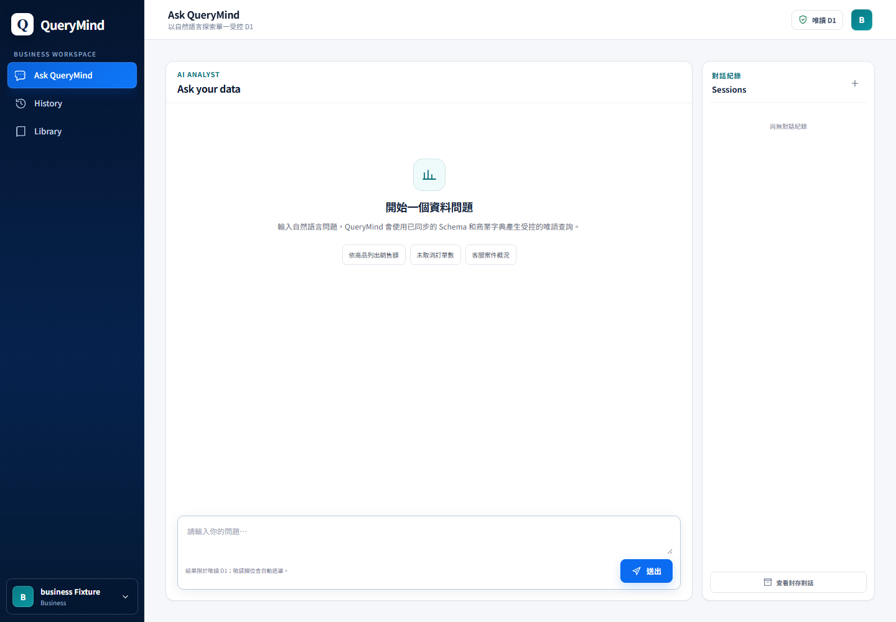
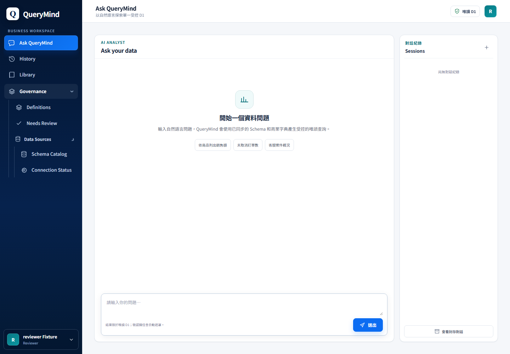
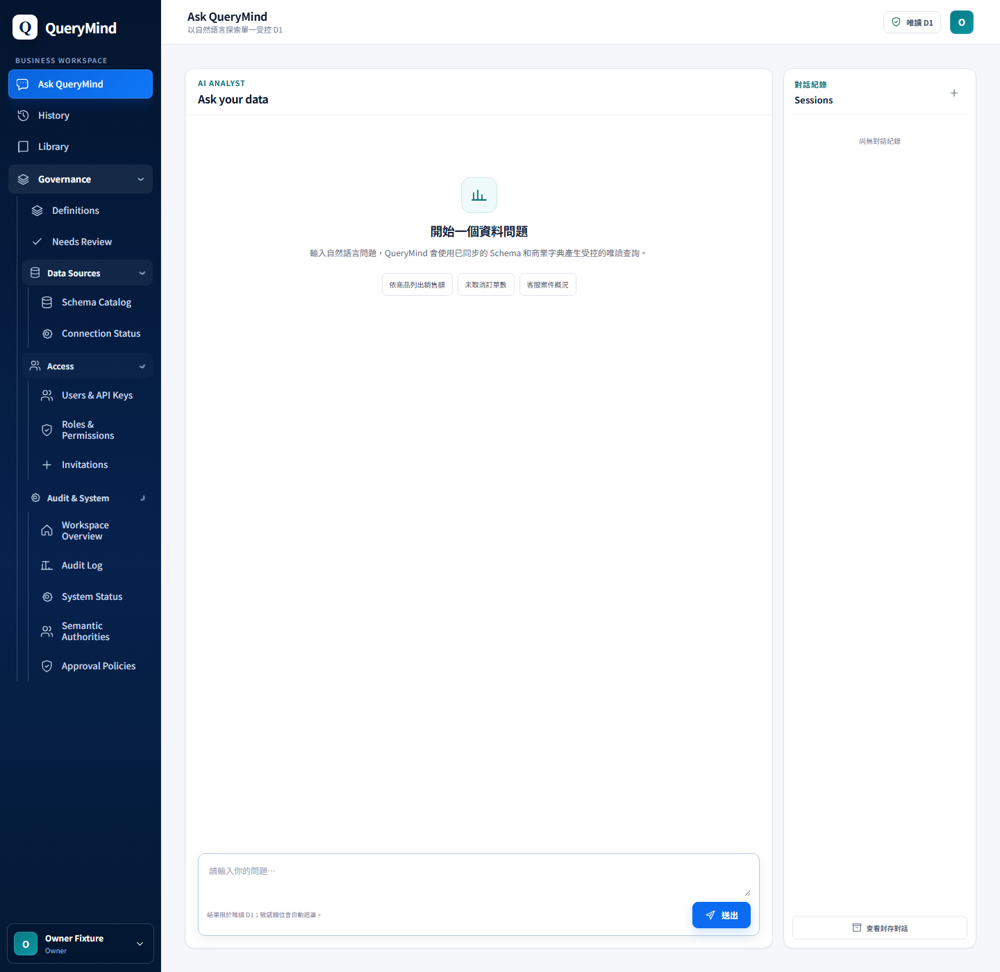

# PX-01 Navigation Implementation

**Status:** COMPLETE locally — disposable Worker/D1 regression passed; Production was not queried or changed.
**Date:** 2026-10-07
**Scope:** Capability-filtered navigation and Ask-first entry. PX-02 explainable-answer work is documented separately in [PX-02 Explainable Answer Experience](px-02-explainable-answer-experience.md). No backend changes, migrations, Production mutations, or deployment.

## Preflight and source of truth

- Branch: `main`
- HEAD at preflight: `40f01ac3cbf78fe7b751bd0651b629ce25c88748`
- APP migrations present: `0001–0013`; DATA migration: `0001`. No migration was added or changed.
- Before this slice the working tree had the pre-existing untracked `docs/product/` audit artifacts. Those files were preserved and updated only where specified below.
- Repository routes and capabilities were taken from `cloudflare/public/app.js`, `cloudflare/src/routes/*`, and the APP migration/seed definitions, not from stale handover text.
- `docs/HANDOVER.md` and `docs/architecture/current-production.md` remain documentation drift relative to repository state. Last known Production evidence in scope is dated 2026-09-09 and recorded a P2-Ia2 verification failure. **Current live state: NOT REVERIFIED IN THIS RUN.** No Production request, deploy, or governance mutation was performed.
- P2-Ia3 / GAP-036 remains an independent governance blocker; PX-01 does not retry or alter it.

## Before → after

Before: the SPA exposed many modules as flat first-level links, including query, schema, dictionary, templates, insights, usage, source, Admin, and Semantic Governance destinations. The Dashboard route was the default authenticated entry.

After: the first level has at most three Business destinations—Ask QueryMind, History, and Library. Governance is a separate expandable group, and its nested groups disappear when none of their leaf destinations are permitted. Usage is reachable from Profile, not primary navigation. Existing functional pages remain the destinations; PX-01 does not redesign them.

## Navigation capability mapping

| Destination | Visibility requirement |
|---|---|
| Ask QueryMind | `chat` |
| History | `manage_own_sessions` |
| Library | Any of `view_templates`, `manage_own_insights`, `view_dictionary`; its cards are independently filtered by the same capabilities |
| Definitions | `view_semantics` |
| Needs Review | Both `view_semantics` and `review_semantics`; opens the existing Semantic list with `revisionStatus=IN_REVIEW` |
| Data Sources → Schema Catalog | `view_schema` |
| Data Sources → Connection Status | `refresh_schema` (existing source-page capability mapping) |
| Access → Users & API Keys / Roles & Permissions / Invitations | `manage_users` |
| Audit & System → Workspace Overview / Audit Log / System Status | `manage_users` (nearest existing authoritative admin capability) |
| Audit & System → Semantic Authorities / Approval Policies | `manage_semantic_governance` |
| Profile → Usage | `view_own_usage` |

Visibility remains a presentation aid only. API authentication and capability authorization remain server-enforced; no Worker route, RBAC rule, scope, query policy, DLP, audit, semantic authority, or approval behavior changed.

## Route compatibility

| Route | PX-01 behavior |
|---|---|
| `/` with authenticated user | Defaults to `#/chat` / Ask QueryMind |
| `#/chat` | Ask QueryMind |
| `#/ask` | Alias to the chat view; route remains bookmarkable |
| `#/dashboard` | Legacy alias to chat/Ask; Dashboard API and renderer remain in code but are no longer the default or primary destination |
| `#/history` | New History surface; selecting an owned session opens it in Ask |
| `#/library` | New lightweight landing page linking to capability-permitted existing Templates, Insights, and Dictionary views |
| `#/templates`, `#/insights`, `#/dictionary`, `#/schema`, `#/source`, `#/usage`, and existing Admin hashes | Existing destinations retained; navigation grouping does not merge their route contracts |
| `#/semantics` | Existing Semantic view, user-facing title “Definitions” |
| `#/definitions` | Alias to the existing Semantic view |
| `#/needs-review` | Existing Semantic view with the current `IN_REVIEW` revision filter |
| Unknown or unauthorized hash | Replaced with Ask when `chat` is available; otherwise the permitted Profile view |
| Direct Query | No SPA navigation route existed before PX-01; its backend/API contract is unchanged and no new link was added |

Reload retains a valid current hash. Session rows in History preserve the selected session and continue in the Ask workspace. Legacy route aliases do not grant capabilities; unauthorized navigation falls back before rendering the protected view, and backend denial remains authoritative.

## Files changed

- `cloudflare/public/app.js`
- `cloudflare/public/styles.css`
- `cloudflare/tests/app.spec.ts`
- `cloudflare/tests/helpers.ts`
- `cloudflare/tests/semantic-governance-ui.spec.ts`
- `cloudflare/tests/semantic-suggestions-ui.spec.ts`
- `docs/product/querymind-target-ia-v1.md`
- `docs/product/querymind-simplification-backlog-v1.md`
- `docs/product/px-01-navigation-implementation.md`
- `docs/product/evidence/px-01/ask-default.png`
- `docs/product/evidence/px-01/business-nav.png`
- `docs/product/evidence/px-01/governance-nav.png`
- `docs/product/evidence/px-01/owner-nav.png`

No source under `cloudflare/src/`, migration, Wrangler/deployment configuration, or Production data was changed.

## Verification

| Check | Result |
|---|---|
| `node --check public/app.js` | PASS |
| `npm run typecheck` | PASS |
| `npm run migration:check` | PASS — protected migrations 0006–0013 remain immutable |
| `git diff --check` | PASS; Git emitted line-ending conversion warnings only |
| `npm run test:db:init` | PASS — disposable local D1 initialized with APP `0001–0013` and DATA `0001` in a task-specific `%TEMP%` directory |
| `npm run check` | PASS — Wrangler types generated and TypeScript typecheck passed using local elevated permissions after the sandbox ACL denied the first attempt. |
| `npm run migration:check` | PASS — protected migrations 0006–0013 remain immutable. |
| Disposable D1 migrations | PASS — APP `0001–0013` and DATA `0001`; each final full run used a newly initialized temporary D1. |
| Wrangler local Worker | PASS — started on localhost with one-time dummy secrets and mock AI; canonical query and route/reload/back-forward checks passed. |
| `npm run test:unit` | PASS — 114/114. |
| `npm run test:e2e` | PASS — 29/29 on a disposable local Worker/D1. |
| `npm run test:all` | PASS — final complete suite 146/146 on clean disposable local D1, including product/RBAC, P0 security, P1 explainability/feedback and Semantic tests. |
| Wrangler deployment dry-run | PASS — 3 static assets, 390.23 KiB / 82.26 KiB gzip; `--dry-run` exited without upload/deployment. |
| Mobile and visual checks | PASS — route and viewport checks; screenshot evidence uses seeded demo data only. |
| Production / GitHub | NOT TOUCHED — no Production request, deployment, D1 mutation, or GitHub/CI operation. |

The initial sandbox run hit Windows ACL errors in Wrangler type generation, local Worker startup, and Chromium launch. These were local process/file permission restrictions, not source failures; re-running the local verification with approved elevated permissions succeeded. A fresh `npm ci` was not completed because package registry access was denied; tests used dependencies copied from the existing locked local environment. No source workaround was added for the ACL issue.

## Remaining UX debt and next slice

- PX-01's History and Library are intentionally lightweight entry surfaces; their underlying pages remain distinct.
- Data Sources, Access, and Audit & System are navigation groupings, not consolidated pages.
- Direct Query has no first-class SPA destination in the current code and remains outside PX-01 scope.
- The Owner navigation is longer than the viewport and scrolls within the sidebar; all destinations remain discoverable through expandable groups.
- PX-01 is complete for local verification. Production visual validation and deployment were intentionally not performed; the current request's scope was local implementation/verification only.
- PX-02 is complete locally and has its own [closeout/evidence report](px-02-explainable-answer-experience.md). The next single suggested slice is contextual Save to Library after a successful answer, preserving ownership and rerun reauthorization.
