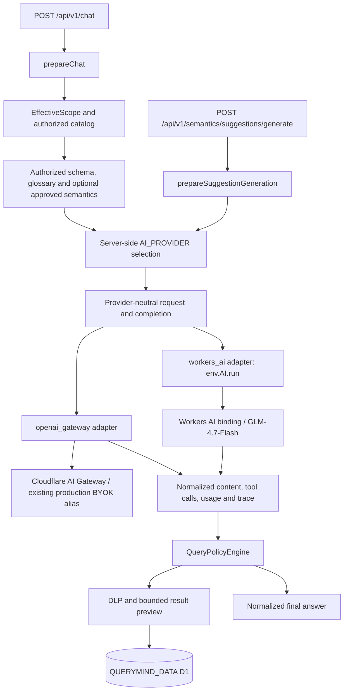

# PX-AI-01 — Multi-Provider AI Runtime

**Implementation state:** Provider abstraction and mocked compatibility coverage are implemented. No Production deployment or provider switch occurred.

**Closeout status:** `WORKERS AI NOT READY`. CI-style regression and disposable D1/E2E verification pass. The first correctly configured live Workers AI smoke returned HTTP 502; its provider error code and trace reference were not recoverable, so agent/tool compatibility tests were correctly not started.

**Production state:** Existing OpenAI Gateway provider, `production` BYOK alias, and Production Worker configuration remain unchanged. Workers AI is not enabled in `wrangler.production.jsonc`.

## Runtime architecture



The only accepted provider IDs are `openai_gateway` and `workers_ai`. Selection comes from Worker environment configuration, never the request body or model output. If `AI_PROVIDER` is absent, the legacy `openai_gateway` provider remains selected for compatibility. An invalid provider, invalid model, missing Gateway configuration, or missing Workers AI binding fails closed. An upstream error never triggers cross-provider fallback.

`wrangler.jsonc` defines the Workers AI `AI` binding and the preview model setting. `wrangler.production.jsonc` was intentionally not changed and its dry-run shows no `AI` binding. No Production deployment or provider switch occurred in this phase.

## Existing request contract preserved

The chat route still resolves the authenticated user, feature capability, owned session, user/global rate limits, EffectiveScope, authorized schema catalog, optional approved semantic context, filtered glossary, and bounded conversation history before provider egress. The existing system prompt is unchanged.

The OpenAI Gateway adapter preserves the previous request contract:

- configured OpenAI model from the server-side allowlist;
- temperature `0.1` and `max_completion_tokens: 800` for chat;
- provider-neutral message history serialized to OpenAI chat-completion messages;
- one `run_readonly_sql` function tool on the first turn, `tool_choice: auto`, and `parallel_tool_calls: false`;
- at most one tool call is accepted; the result is returned to the model in a second completion;
- SQL goes through `authorizeQuery`, DLP checks, bounded row preview, masking, and the existing data binding. The model is not an authorization boundary.

Semantic suggestion generation also uses the same server-side provider selection. Its OpenAI request retains temperature `0`, `max_completion_tokens: 3000`, and JSON-object response mode; Workers AI receives the same structured request. Existing design-time suggestion validation and retry cap remain in place.

## Tool-call normalization

Adapters translate provider-specific responses into `{ content, toolCalls, finishReason?, trace }`. Each normalized tool call is `{ id, name, arguments }`, with `arguments` validated as a JSON object and serialized canonically. OpenAI calls must supply an ID and function shape. Workers AI responses support both its documented `{ response, tool_calls, usage }` form (where tool arguments can be objects and may not have an ID) and the OpenAI-compatible `choices[].message` form. A synthetic opaque call ID is assigned only when Workers AI omits one, then carried unchanged into the assistant tool-call and tool-result messages for the second turn.

Malformed tool payloads fail as `AI_PROVIDER_INVALID_RESPONSE`; unsupported names or multiple SQL calls are rejected before execution. No provider adapter executes SQL.

## Error taxonomy and retry behavior

Provider failures use safe public error codes without provider response text:

| Code | Meaning | HTTP |
|---|---|---:|
| `AI_PROVIDER_RATE_LIMIT` | Provider rate limiting | 429 |
| `AI_PROVIDER_QUOTA` | Quota/credit exhaustion | 429 |
| `AI_PROVIDER_AUTH` | Provider or Gateway authentication/authorization | 502 |
| `AI_PROVIDER_TIMEOUT` | Provider deadline exceeded | 504 |
| `AI_PROVIDER_BAD_REQUEST` | Provider rejected the request shape | 502 |
| `AI_PROVIDER_UPSTREAM` | Other upstream/network failure | 502 |
| `AI_PROVIDER_INVALID_RESPONSE` | Response or tool-call shape is invalid | 502 |
| `AI_PROVIDER_CONFIG` | Provider/model/binding configuration is invalid | 503 |

Chat performs no automatic retry or cross-provider fallback. The existing semantic suggestion flow remains capped at two total attempts and retries only the previously retryable upstream/timeout/invalid-output classes plus rate-limit/quota failures; auth, bad request, and configuration errors are not retried.

Workers AI's native binding has no request `AbortSignal` parameter in the current binding API. The adapter applies a 30-second caller deadline and handles disconnects, but that deadline does **not** cancel remote model execution already accepted by Workers AI. This is a known cost/latency limitation; do not infer provider cancellation from the Worker response ending.

## Privacy, trace and usage metadata

- AI Gateway requests use a random `cf-aig-event-id`, metadata `{ "product": "querymind" }`, the existing `production` BYOK alias when configured, and documented `cf-aig-collect-log-payload: false`.
- User IDs and session IDs are no longer attached as AI Gateway metadata. Gateway/provider bodies, prompts, completions, SQL scope predicates, credentials, and result rows are not written to provider trace logs.
- Structured success/failure logs and the additive chat response/history metadata include provider ID, model, random reference IDs, status, timestamp, latency, and token usage when the provider returns it. Failure logging records only normalized code/status and safe references.
- `ai_usage_events` remains unchanged and stores its existing per-user/session usage counters and model/duration fields; token usage and provider ID are not added to that table in this phase, so no migration is introduced. Provider-level token usage is returned in the request trace and included in the existing governed query audit metadata when available.
- Workers AI uses the native binding and does not send the OpenAI Gateway `production` alias or any OpenAI credential.

## Pricing and activation gate

The initial model is `@cf/zai-org/glm-4.7-flash`. Cloudflare documents function-calling support and Free-plan availability. Its published unit prices are `$0.0605 / million input tokens` and `$0.40 / million output tokens`; the platform meters Neurons, includes 10,000 Neurons per day, rejects further requests on Workers Free after the daily allocation, and bills excess usage on Workers Paid at `$0.011 / 1,000 Neurons`. The account plan and remaining daily allocation were not inspected. One harmless live smoke was attempted after verifying the binding mode; it returned HTTP 502, and whether it consumed any allocation is unknown. See [model pricing](https://developers.cloudflare.com/workers-ai/models/glm-4.7-flash/) and [Workers AI pricing](https://developers.cloudflare.com/workers-ai/platform/pricing/).

Production remains on the existing OpenAI Gateway path. A future Production activation requires explicit operator approval, verifying Workers AI binding in the production deploy configuration, setting `AI_PROVIDER=workers_ai` and the approved model server-side, confirming account plan/billing and limits, deploying through the Cloudflare-only runbook, and performing authenticated post-deploy verification. This implementation does not change the runtime provider automatically.

## Workerd / D1 stabilization evidence

- Environment: Windows, Node `22.16.0`, Wrangler `4.120.1`, Workerd `1.20260804.1`.
- Failing command: `npm run test:db:init` in `cloudflare/`, using the repository script's `wrangler d1 execute <db> --local --persist-to=<fresh path> --file=<migration>` invocations. The initial disposable state was `.wrangler-pxai-closeout-20261012`; captured Workerd output included `connect EACCES 127.0.0.1:9229`, an Assets watcher `EPERM`, and `std::terminate()` (Workerd PID `19412`). The Wrangler Node PID was not captured separately. This is not evidence of a D1 migration defect.
- Reproduction/control: the same command on another fresh disposable path (`.wrangler-pxai-dbinit-confirmed-20261012`) completed successfully when run with the required local IPC/socket access. APP initialization applied SQL files `0001–0013`; DATA applied `0001`. The local Worker health check then returned `200` with both databases healthy. This isolates the failure to sandbox restrictions on local Workerd IPC/socket and file watching, not Workerd/D1 incompatibility.
- The repository's `test:db:init` applies migration SQL directly; it does not populate Wrangler's `_cf_Migrations` ledger. Consequently `wrangler d1 migrations list --local` reports those source files as pending even though the disposable schema was created and verified by the repository initializer. This is a test-fixture implementation detail, not Production migration state.
- A clean temporary source copy excluded `.dev.vars`, `.env*`, and Wrangler state. Its `node_modules` was a junction to the existing install, so this was equivalent source isolation, not a fresh clone or `npm ci`.

## Live Workers AI attempt

- The first local invocation mistakenly used Wrangler `--local`, which disables configured remote bindings; Wrangler reported `env.AI` as `not supported`. No provider inference was reached in that attempt.
- The corrected isolated invocation was `wrangler dev --port 8789 --persist-to .wrangler-pxai-live-20261012-7f21` with `ENVIRONMENT=local`, `AI_PROVIDER=workers_ai`, `AI_MOCK_MODE=false`, `WORKERS_AI_MODEL=@cf/zai-org/glm-4.7-flash`, and `SEMANTIC_RUNTIME_CONTEXT_ENABLED=false`. Wrangler reported `env.AI` as `remote` while `QUERYMIND_DATA` and `QUERYMIND_APP` remained `local`. The disposable-only smoke route sent a single no-tool instruction (“Reply with exactly READY. Do not access data or tools.”); it contained no business data or SQL. The local route was temporary to this isolated copy and was not added to repository source.
- That request returned HTTP `502` after approximately `70 ms`. The Worker emitted an access-log `502`, but the response body/provider error code and provider trace reference were not retained by the PowerShell HTTP wrapper. No exact provider cause can therefore be asserted. No chat/tool-loop or C01–C10 live case was run after this failure, and no retry or alternate provider was attempted.
- No adapter defect is proven. The Workers AI input shape, live response normalization, function-call structure, grounded SQL loop, trace correlation, and model quality remain unverified. The adapter was not changed.

## Verification and remaining limits

- `npm run check`: PASS (Wrangler type generation and TypeScript typecheck).
- `npm run test:unit`: PASS, 127/127, including provider selection, OpenAI request-shape mocks, Workers AI normalization mocks, security, privacy, and error taxonomy.
- `npm run migration:check`: PASS; protected migrations `0006–0013` are immutable; no migration was added. Release manifest checks passed.
- Fresh disposable D1 initialization: PASS; APP `0001–0013`, DATA `0001`. Separate `npm run test:e2e`: PASS, 36 tests.
- `npm run test:all`: PASS on the CI-style local Worker and disposable D1. Playwright discovery enumerated 165 tests in 16 files; the full-run output did not retain a separate passed-test count.
- Preview and Production-config dry-runs: PASS. The Production dry-run contains only the configured D1 and Assets bindings and no Workers AI binding. No deployment, remote D1 access, GitHub push, or live OpenAI request occurred.
- `git diff --check` and `node --check public/app.js`: PASS.
- Workers AI live inference: FAIL (HTTP `502`); exact normalized provider cause and trace are unavailable. C01–C10 live compatibility were not run. Mocked C01–C10 coverage remains green but does not establish live readiness.

### Compatibility matrix

| Case | Mock/regression coverage | Live Workers AI result |
|---|---|---|
| C01 canonical aggregation | PASS | NOT RUN — stopped at failed smoke |
| C02 ordering/top result | PASS | NOT RUN — stopped at failed smoke |
| C03 filter/time interpretation | PASS | NOT RUN — stopped at failed smoke |
| C04 authorized join | PASS | NOT RUN — stopped at failed smoke |
| C05 ambiguous question | PASS | NOT RUN — stopped at failed smoke |
| C06 unauthorized source attempt | PASS (deterministic policy test) | NOT RUN — stopped at failed smoke |
| C07 prompt injection | PASS (provider cannot choose provider/scope) | NOT RUN — stopped at failed smoke |
| C08 sensitive/DLP case | PASS (DLP rejection test) | NOT RUN — stopped at failed smoke |
| C09 malformed tool arguments | PASS (malformed-response fixture) | NOT APPLICABLE to a deterministic live model output; live adapter still unverified |
| C10 multi-turn follow-up | PASS (mocked normalization loop) | NOT RUN — stopped at failed smoke |

### Privacy, trace, and usage status

- QueryMind code logs provider ID, model, random reference, status, latency, and token usage only; it does not log prompts, completions, SQL scope predicates, credentials, or result rows. Preview Worker observability is enabled, so safe application metadata can be retained as Worker logs.
- The OpenAI Gateway adapter sets `cf-aig-collect-log-payload: false`; that setting does not apply to the direct Workers AI binding. No AI Gateway trace/event is expected for Workers AI. The failed live request did not provide a QueryMind reference in the captured response, so provider-to-Worker trace correlation is not verified.
- Cloudflare states that Workers AI Customer Content is not made available to other customers or used to train/improve services without explicit consent, and may be stored if Cloudflare storage products are used with it. No such storage product is used by this adapter. Account-specific observability retention/settings were not inspected. See [Workers AI data usage](https://developers.cloudflare.com/workers-ai/platform/data-usage/) and [Workers Logs](https://developers.cloudflare.com/workers/observability/logs/workers-logs/).
- Existing `ai_usage_events` has no provider-ID column, so that table cannot independently distinguish providers without a future migration. Current chat traces/query audit metadata include provider attribution; no schema change was made.

### Final activation gate

```text
WORKERS AI NOT READY
Production provider switch: NOT APPROVED
Production Worker/config/D1: unchanged
Automatic cross-provider fallback: disabled
Semantic Runtime / Governance: unchanged
Migrations: NONE
Production recommendation: DO NOT SWITCH
Next action: recover the safe Workers AI 502 code/reference and confirm account usage/plan, then repeat only the harmless smoke before attempting C01–C10.
```

## Workers AI Live Connectivity Investigation

This dated addendum supersedes the earlier account-unknown and retry-pending statements above; those entries are retained as historical evidence.

- Preview configuration was verified from the disposable Wrangler runtime: `AI_PROVIDER=workers_ai`, `WORKERS_AI_MODEL=@cf/zai-org/glm-4.7-flash`, `AI_MOCK_MODE=false`, `env.AI` remote, and both `QUERYMIND_APP` and `QUERYMIND_DATA` D1 bindings local to disposable state. The route did not access either D1. There was no OpenAI adapter or fallback in the isolated harness; Production configuration and traffic were untouched.
- Cloudflare read-only account checks on 2026-10-12 showed Workers Free active, Workers AI usage `372.54 / 10,000` Neurons for the day (`9,627.46` remaining), and the configured model present in the authenticated account-visible model catalog. No quota exhaustion, plan restriction, suspension, or account-level disablement was shown. Account availability is therefore `AVAILABLE` for the inspected state.
- Exactly one minimal Preview request was sent after preflight: a single user message, `Return exactly: READY`; no tools, token/temperature overrides, business data, SQL, schema, semantic context, or QueryMind prompt. The direct `env.AI.run()` call fulfilled, but the response did not pass the harness's exact `READY` response check. The temporary harness returned HTTP 502 after `3,131 ms`; it logged only `reference_id=b60d6684-5b4a-4b15-82bc-c628df264689`, provider, model, status, latency, and `response_parsing=fail`. No response text was inspected or logged. This 502 was generated by the harness response check, not evidence of an upstream HTTP 502.
- Safe failure classification for the original provider 502 remains `W8 — Unknown`: the earlier request had no retained provider error code or Cloudflare trace ID. The single controlled retry produced no thrown provider error, Cloudflare error code, or trace/request ID, so it does not identify the earlier failure. `W7` is not established because the retry did not capture whether the returned output shape was invalid or merely not the exact requested text. No further retry was made.
- No operational/configuration cause was proven or corrected. A focused source change in `cloudflare/src/lib/ai-provider.ts` added allow-listed Workers AI error metadata extraction/classification and latency logging without reading exception messages/bodies; `cloudflare/tests/ai-provider.spec.ts` adds a privacy regression test. The retry succeeded at the binding-call level but did not exercise that exception-metadata path, so the change did not establish the cause of the earlier 502.
- Local verification after the source change: typecheck PASS; unit tests PASS, `128/128`; migration check PASS. The full 166-test Playwright suite did not pass: latest run `131 passed, 14 failed, 21 did not run`; the earlier post-bootstrap run was `140 passed, 15 failed, 11 did not run`. Failures were local test-account login rate limits persisted in the disposable D1 across runs; no Production resource was targeted. Regression is not green, so no readiness promotion is made.
- No live C01–C10, RBAC, EffectiveScope, DLP, prompt-injection, join, or tool-calling evaluation was performed against Workers AI. No Production deploy, provider switch, D1 migration, Semantic/Governance mutation, or GitHub push occurred. OpenAI fallback: `NOT USED`.

```text
WORKERS AI CONNECTIVITY: NOT READY
ORIGINAL 502 CLASSIFICATION: W8 — UNKNOWN
CONTROLLED RETRY: EXECUTED ONCE; EXACT READY NOT CONFIRMED
PRODUCTION: UNCHANGED
NEXT STEP: diagnose the safe response-shape/result mismatch and make the disposable regression fixture reset its local rate-limit counters before any separately authorized follow-up; do not repeat this smoke in this run.
```

Relevant Cloudflare references:

- [Workers AI GLM-4.7-Flash model](https://developers.cloudflare.com/workers-ai/models/glm-4.7-flash/)
- [Workers AI traditional function calling](https://developers.cloudflare.com/workers-ai/features/function-calling/traditional/)
- [Workers AI pricing](https://developers.cloudflare.com/workers-ai/platform/pricing/)
- [Workers AI data usage](https://developers.cloudflare.com/workers-ai/platform/data-usage/)
- [Workers Logs](https://developers.cloudflare.com/workers/observability/logs/workers-logs/)
- [Workers AI and AI Gateway bindings](https://developers.cloudflare.com/ai-gateway/usage/worker-binding-methods/)
- [AI Gateway payload logging controls](https://developers.cloudflare.com/ai-gateway/observability/logging/)
- [Cloudflare local development and remote bindings](https://developers.cloudflare.com/workers/local-development/)

## PX-AI-01A2 Response Contract / Test Isolation (2026-10-12)

This addendum preserves the earlier A1 evidence and separates its two different 502 observations:

- The original short request was recorded as a Worker/provider failure: HTTP `502`, about `70 ms`, safe application code `AI_PROVIDER_UPSTREAM`, reference `b1220699-2980-48a5-a412-0031484f64bc`. No Cloudflare provider error code or trace was retained, so its provider-side cause remains `W8 — Unknown`.
- The later controlled harness request was different: `env.AI.run()` fulfilled in about `3,131 ms`, then the temporary harness required `result.response` to equal `READY` and returned its own HTTP `502` (`SAFE_RESPONSE_MISMATCH`, reference `b60d6684-5b4a-4b15-82bc-c628df264689`). That was a harness/parser-check failure, not an upstream provider 502. The harness did not retain the raw response structure, so it does not prove what that live response contained.

### Model and response contract evidence

- The configured model and the value validated before `env.AI.run(request.model, ...)` are both exactly `@cf/zai-org/glm-4.7-flash`; the model ID has not been normalized or stripped of `@`.
- Wrangler-generated `cloudflare/src/worker-configuration.d.ts` maps that exact model to `ChatCompletionsOutput`, whose shape is `{ id, object, created, model, choices, usage? }`. Each choice has `index`, `message`, and `finish_reason`; the message has `content` and optional `tool_calls`. This is generated binding-type evidence for the contract, not a claim that the A1 harness captured those keys at runtime. Cloudflare's [Workers AI binding docs](https://developers.cloudflare.com/ai-gateway/usage/worker-binding-methods/) document the `env.AI.run()` binding, and the [traditional function-calling contract](https://developers.cloudflare.com/workers-ai/features/function-calling/traditional/) describes tool calls in the response.
- The adapter already handled a `choices[].message` value, so the A1 temporary harness's `response`-only assumption was not evidence of a QueryMind production adapter defect. A2 tightens the contract: `choices` must be a non-empty array when present; unsupported/malformed shapes fail as `AI_PROVIDER_INVALID_RESPONSE`; normalized output preserves `content`, `toolCalls`, `finishReason`, and optional usage. The legacy native `{ response, tool_calls, usage }` shape remains supported.
- Preview-only `ai_provider.response_shape` diagnostics contain allow-listed structural keys, content type/length, usage presence, tool-call count, and finish-reason presence. They never log generated content, tool arguments, prompts, or arbitrary provider keys. This is available for the authorized one-time Preview smoke if reached.

### Rate-limit isolation and retained coverage

- Login counters persist in APP D1 table `rate_limit_counters`, keyed by hashed subject and fixed-window start. Login consumes a global 24-hour bucket plus IP and account 15-minute buckets; the account threshold remains the configured production value, and expiry is bounded by the existing opportunistic cleanup rule. No Production threshold or policy changed.
- The previous local full-suite workflow could reuse a persisted disposable D1 across suites, so legitimate failed-login counters could contaminate later runs. CI already creates a fresh disposable D1. `npm run test:all` now follows the same isolation principle for local use by initializing a unique disposable persistence path and a local Worker; when CI supplies an explicit loopback `QUERYMIND_TEST_URL`, it keeps using that CI-managed fresh D1/Worker. The runner rejects non-local targets.
- Added isolated unit coverage for threshold enforcement and denial, fixed-window rollover, and expiry cleanup. The suite still exercises throttling; rate limiting was neither disabled nor raised as a workaround.

### A2 verification result

- `npm run check`: PASS.
- `npm run test:unit`: PASS, `135/135` (including provider normalization/privacy, multiple/malformed tool-call fixtures, and three rate-limit contract tests).
- `npm run migration:check`: PASS; no migration added. Both release-manifest checks: PASS.
- Fresh local D1 initialization / E2E / `test:all`: BLOCKED before tests started. On Windows 11, Node `22.16.0`, Wrangler `4.120.1`, a fresh `wrangler d1 execute --local --persist-to=<unique disposable path>` aborted in the bundled Workerd runtime with `*** std::terminate() called with no exception`; the first DATA D1 fixture command did not complete. A second fresh disposable path reproduced the same failure. No D1 migration mismatch was established, and no Production/remote D1 was targeted. The repository config contains Assets but no explicit `tail_consumers`; Cloudflare's open [Workerd Windows issue](https://github.com/cloudflare/workerd/issues/6913) documents this signature in a narrower tail-consumer/peer-shutdown condition, which is not enough to attribute this reproduction to that same cause.
- The isolated runner was verified to stop before Playwright/E2E when its local D1 initializer fails. Therefore E2E and full-suite counts are `0 passed / 0 failed / 0 skipped / 0 did-not-run` because no tests were launched; they are not PASS. The full regression gate is not green.
- Production-config `wrangler deploy --dry-run`: PASS; it listed only APP D1, DATA D1, and Assets, with no Workers AI binding. No deployment or Production provider change occurred. `git diff --check`, `node --check scripts/run-test-all.mjs`, and `node --check public/app.js`: PASS (Git emitted only existing LF-to-CRLF working-copy warnings).
- No additional live request was sent. The required Stage C smoke is gated on a green full regression, which this Windows Workerd failure prevents. Actual live response keys, normalized `READY`, and connectivity remain unverified. No C01–C10 live cases were run.

```text
WORKERS AI CONNECTIVITY: BLOCKED — NO A2 SMOKE
GENERATED MODEL CONTRACT: ChatCompletionsOutput / choices[].message
LIVE RESPONSE SHAPE: NOT CAPTURED
REGRESSION: UNIT PASS; FULL SUITE BLOCKED AT WINDOWS LOCAL WORKER RUNTIME STARTUP
PRODUCTION PROVIDER / WORKER / D1: UNCHANGED
OPENAI FALLBACK: NOT USED
NEXT GATE: restore a working isolated local Workerd/D1 runtime, achieve a green full regression, then perform exactly one authorized READY Preview smoke. Do not begin PX-AI-01B before that gate.
```

## PX-AI-01A3 CI authority and Windows Workerd limitation (2026-10-15)

This addendum supersedes A2's local-runtime recovery as the release gate:

- Windows local Workerd/D1 initialization has reproduced `*** std::terminate() called with no exception` against fresh disposable persistence paths. The first DATA D1 fixture command did not complete; no migration mismatch or QueryMind application defect was established.
- Workerd issue [#6913](https://github.com/cloudflare/workerd/issues/6913) has a similar Windows termination signature but documents a narrower tail-consumer/peer-shutdown topology. QueryMind has not been shown to meet those conditions; relationship is `POTENTIALLY RELATED / NOT PROVEN`.
- Linux GitHub Actions is the authoritative PX-AI-01 full-regression gate. Windows remains suitable for typecheck, deterministic unit tests, migration checks, syntax checks, and deployment dry-run, but not as the sole full-release gate while this local runtime instability persists.
- The reviewed CI workflow uses `ubuntu-latest`, Node 22, `npm ci` from the checked-in lockfile (Wrangler `4.120.1`, Workerd `1.20260804.1`), fresh local APP migrations `0001–0013`, DATA migration `0001`, and `AI_MOCK_MODE=true` for local Worker/E2E. It does not configure Production D1 or Production provider credentials; live Workers AI is not a CI dependency.
- The Windows failure remains an environment limitation, not an upstream Workerd root-cause finding. Connectivity smoke remains gated on a green Linux CI run for the exact PX-AI commit.

```text
WINDOWS WORKERD: LOCAL DEVELOPMENT LIMITATION
WORKERD #6913 RELATIONSHIP: POTENTIALLY RELATED / NOT PROVEN
AUTHORITATIVE FULL REGRESSION: GITHUB ACTIONS / LINUX
LIVE WORKERS AI SMOKE: ONLY AFTER EXACT-COMMIT CI PASS
PRODUCTION: UNCHANGED
```
