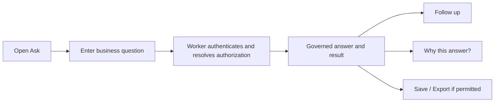
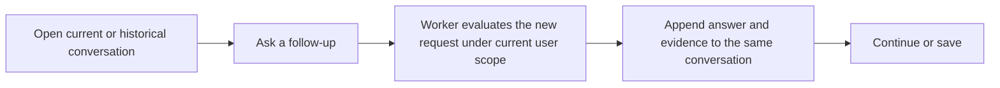
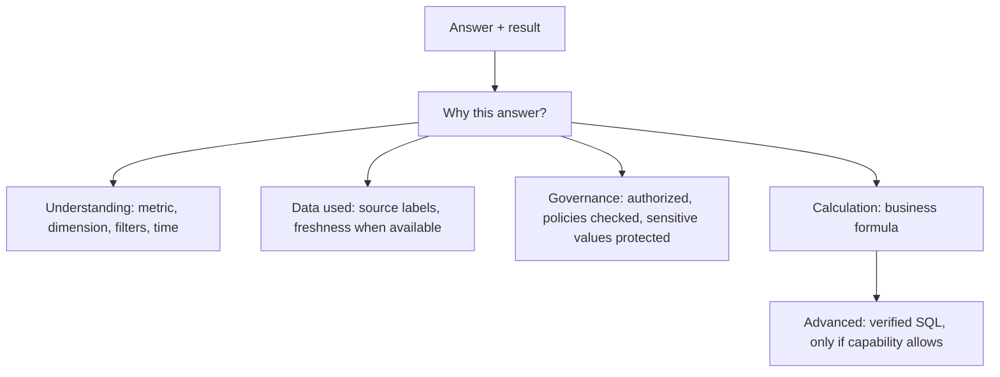
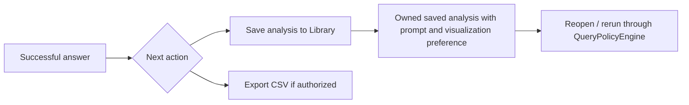
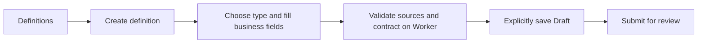
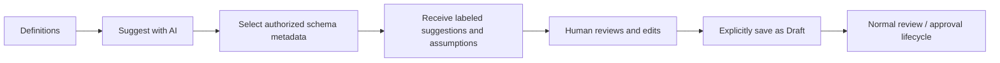
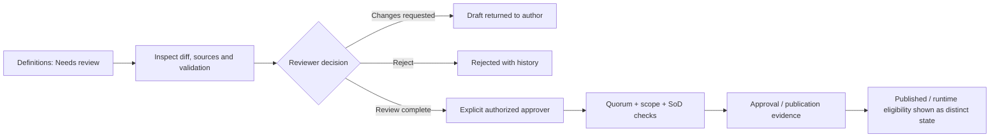
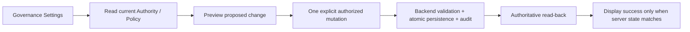

# QueryMind Target Information Architecture V1

**Status:** Target IA with PX-01/PX-02/PX-03 local implementation evidence, updated 2026-10-07; Production unchanged
**Invariant:** Organize the frontend around user jobs while leaving Worker authorization and governance contracts authoritative.

## 1. Navigation tree

### Business User

```text
QueryMind
├─ Ask QueryMind                         [default]
├─ History
├─ Library
│  ├─ Saved analyses
│  └─ Team question starters
└─ Account menu
   ├─ Profile / password
   └─ Usage
```

### Governance User

```text
QueryMind
├─ Business Workspace                   [capabilities: chat / session]
│  ├─ Ask QueryMind
│  ├─ History
│  └─ Library
└─ Governance Workspace                 [show only permitted areas]
   ├─ Definitions
│  ├─ My drafts / all definitions       [view_semantics]
│  ├─ Needs review                      [review_semantics]
│  ├─ Create definition                 [manage_semantic_drafts]
│  └─ Suggest with AI                   [manage_semantic_drafts; explicit action]
   ├─ Data Sources                       [view_schema / refresh_schema]
   ├─ Access                             [manage_users]
   └─ Audit & System                     [manage_users / specific admin capability]
      ├─ Audit
      ├─ Operations status
      └─ Governance Settings             [manage_semantic_governance]
         ├─ Approval access (explicit authorities)
         └─ Approval rules (risk, quorum, separation of duties)
```

All visibility is capability-driven. A role name may suggest common work but must not grant an action. “Approve definition” additionally requires the backend's approval capability, explicit Semantic Authority, active policy, scope match, quorum, and separation-of-duties checks.

### System Owner

System Owner sees Business Workspace plus all Governance Workspace areas permitted by current capabilities. The Owner role's `*` capability provides visibility today, but should not be treated as implicit Semantic approval authority: Semantic approval still depends on explicit authority and backend governance rules. Access is the place for users, role policies, invitations, and per-user API access. Governance Settings is configuration, not part of ordinary definition work.

## 2. Screen inventory

The target has seven authenticated work screens plus required authentication entry states. A screen can have role-filtered panels/actions; this does not require different applications per role.

| Screen | Persona | Primary job / CTA | Secondary actions | Information required | Hidden by default | Supporting APIs |
|---|---|---|---|---|---|---|
| Ask QueryMind | Business, all with `chat` | Ask a business question / **Ask** | Continue, open recent history, use starter, inspect answer, Save, Export if permitted, Feedback | Prompt, current conversation, answer, primary result, brief trust status | Full SQL; technical identifiers; governance rule internals; unrelated account usage | `/api/v1/chat`, `/api/v1/sessions`, `/api/v1/sessions/:id/messages`, `/api/v1/query-runs/:id/feedback`, `/api/v1/export/csv`, `/api/v1/insights` |
| History | Business | Resume a conversation / **Open** | Search, pin, rename, archive/restore, delete with explicit confirmation | Title, last activity, short summary, pinned/archive state | Row predicates, SQL internals, implementation IDs | `/api/v1/sessions`, `/api/v1/sessions/:id/messages`, PATCH/DELETE session |
| Library | Business, Analyst, Editor | Find reusable work / **Open or use** | Save/edit/delete own analysis; favorite; use team prompt starter | Saved analysis title/prompt/description; chart preference; ownership/share state for templates | Raw SQL unless user is capability-authorized and intentionally opens advanced details | `/api/v1/insights`, `/api/v1/templates`, `/api/v1/query` for governed rerun |
| Definitions | Data Owner, DBA, Reviewer, Approver by capability | Create, find, or progress an enterprise definition / **Create definition** or **Review** | Start manually; Suggest with AI; edit draft; submit; review; approve/publish when separately authorized; view activity | Name, type, business definition, owner, status, source labels, latest human-readable lifecycle state | Asset/revision IDs, schema snapshot, registry version, raw AST, technical evidence | `/api/v1/semantics`, `/suggestions`, asset/revision/review/approval APIs; governance config APIs only for authorized settings |
| Data Sources | DBA / capability holder | Understand available governed data / **View catalog**; **Refresh catalog** only with `refresh_schema` | Inspect tables/columns, last refresh and read-only mode | Friendly table/column labels and catalog freshness | Internal app tables, raw SQLite DDL, database IDs, policy predicates | `/api/v1/schema`, `/api/v1/schema/refresh`, `/api/v1/admin/connection` |
| Access | System Owner / `manage_users` | Manage who can enter and what product features they can use / **Invite** or **Change access** | Role policy, disable account, password reset, invitation revoke, per-user API key create/revoke | User, role, active status, explicit capability summary, scope assignment where applicable | Secret hashes, full API key after initial creation, unrelated governance authority | `/api/v1/admin/users`, `/roles`, `/invitations`, `/api-keys`, `/accept-invitation` |
| Audit & System | System Owner / `manage_users`; Governance Settings separately `manage_semantic_governance` | Reconstruct decisions and diagnose service status / **Filter audit** or **Open settings** | Operations status, schema freshness, AI Gateway configured status, Authority/Policy lifecycle | Actor, time, event, resource, safe correlation evidence; summarized service status | Secrets, tokens, cookies, raw row data, internal stack traces | `/api/v1/admin/audit`, `/api/v1/admin/system`, `/api/v1/admin/semantic-runtime/readiness`, governance config endpoints |
| Authentication entry | New/existing member | Login, create first owner, or accept invite / **Continue** | Change password after login | Email, password/token only in the appropriate one-time flow | Application data before authentication | `/api/v1/auth/status`, `/bootstrap-status`, `/login`, `/bootstrap`, `/invitation`, `/accept-invitation` |

## 3. Business flows

### Flow 1 — Business Query



The UI shows the user task; the Worker continues to enforce Authentication → feature RBAC → EffectiveScope → authorized catalog → model egress → QueryPolicyEngine → validated SQL → DLP and result limits.

### Flow 2 — Follow-up Query



Conversation context must never be treated as authorization. A prior result, saved SQL, or answer does not grant access to a table, column, or row.

### Flow 3 — Explainability



All facts must continue to come from deterministic persisted runtime state. Do not generate governance claims from LLM prose. SQL disclosure is collapsed by default and absent when unauthorized.

In the PX-02 implementation, the answer and primary result precede a collapsed “Why this answer?” disclosure. Semantic `USED` evidence nests under Data used; `NOT_USED` is stated plainly. Feedback remains visible beside the successful result, while its correction form is opened only when requested.

### Flow 4 — Save / Library



PX-03 adds the direct Save action to successful governed results. It stores the user's question and bounded note in the existing owner-scoped Insight record, not result rows or a reusable authorization decision. Saved SQL from older Insight records remains a separate legacy contract and is re-authorized through the current governed query route whenever rerun. Prompt-only saved analyses go through the current Chat route.

## 4. Governance flows

### Flow 5 — Create Definition Manually



### Flow 6 — Create Definition with AI



`AI suggestion ≠ draft ≠ approved definition`. The AI action remains explicit; it cannot save, approve, publish, or create authority by itself.

### Flow 7 — Review / Approve Definition



Approval and publication may be visually one lifecycle but must remain distinct backend states. A publication does not by itself switch the global semantic runtime flag.

### Flow 8 — Governance Admin Configuration



This flow applies only to users with `manage_semantic_governance`. It does not grant implicit Owner/DBA approval and does not change business data scope.

## 5. Where current screens/actions go

| Current surface | Target disposition |
|---|---|
| Dashboard | Remove as a standalone page; its question starters and recent conversations become Ask landing content. Move operations/audit summary to Audit & System. |
| AI Chat | Becomes Ask QueryMind, default Business home. |
| Sessions panel | Becomes adjacent History navigation/drawer plus recent sessions within Ask. Archive mode and pin/rename/delete remain contextual session actions. |
| Result table/chart | Remains in the answer, as result view controls. |
| Explainability | Becomes a “Why this answer?” disclosure with summary first and detailed evidence on demand. |
| Verified SQL | Moves inside a collapsed Advanced disclosure and remains capability-gated. |
| Feedback | Remains in the answer footer; negative details expand on demand. |
| CSV Export | Remains a result action and is shown only when capability permits; server still authorizes. |
| Direct Query | No new first-level page. Keep direct query as internal/advanced API path; saved analysis rerun continues through policy. |
| Saved Insights | Moves into Library as Saved analyses; successful answers can be saved in context. Existing Insight APIs and ownership checks remain authoritative. |
| Query Templates | Moves into Library as Team question starters; surface selected examples in Ask. |
| Business Dictionary | Becomes a Business terms view/filter inside Definitions, with explicit “helper vocabulary” vs “approved definition” status. Existing dictionary tables remain separate. |
| Schema | Moves to Governance → Data Sources as Catalog detail. |
| Source / connection | Merges into Data Sources; one freshness/status view and one capability-gated refresh action. |
| Usage | Moves to Account → Usage. Keep the endpoint and per-user scope. |
| Profile | Moves to the account menu; never primary navigation. |
| Semantic Registry | Renames to Definitions and becomes the governance work hub. |
| AI Suggestions | Becomes a “Suggest with AI” action in Create Definition; results are a draft-preparation step, not a separate product workspace. |
| Definition detail tabs | Overview and business definition become the main page; sources and history move into secondary panels; approval/review actions appear when capability and state allow. |
| Review tab | Becomes a Needs review filter/queue within Definitions. Detail retains review history. |
| Approval / publication / runtime readiness | Becomes one human-readable lifecycle timeline with advanced readiness details; never conflate states. |
| Authority / Policy pages | Move to Governance → Audit & System → Governance Settings, behind `manage_semantic_governance`. |
| Admin Overview | Remove standalone page; retain actionable status where the relevant operator works. |
| Users / Roles / Invitations | Consolidate under Governance → Access: Members, Role policies, Invitations. |
| API Key modal | Remains within a selected member's Access detail; one-time key display, never a primary destination. |
| Audit | Remains a first-level Governance workspace destination, with filters and event detail. |
| System / Data Connection | Move to Audit & System → Operations; keep secret-safe status only. |
| Login / bootstrap / invite acceptance | Remain explicit auth/onboarding entry states outside authenticated navigation. |

## 6. Security regression matrix

Every row represents a UI change that must be paired with server-side negative and positive tests. Existing APIs already enforce several of these controls; a future UI change must not weaken them.

| UI change | Required regression checks |
|---|---|
| Business/Governance nav split and default Ask | Auth and capability-based route visibility; direct deep link still rejected if unauthorized; backend RBAC remains final authority |
| History drawer/route merge | Session ownership for list, read, update, archive, restore, delete, and messages; cross-user session ID denied |
| Answer + follow-up consolidation | Authentication, `chat` capability, EffectiveScope resolved before catalog, no prompt-injected scope expansion |
| “Why this answer?” disclosure | Explainability only for successful governed runs; facts sourced deterministically; no raw scope keys/predicates/secrets |
| Advanced SQL collapsed | `view_schema`/`rawSqlAvailable` controls both UI and API payload; no SQL shown to unauthorized role in stored or live run |
| Contextual Save / Library | Own-insight ownership; stored SQL reauthorized when created/updated and on every rerun; saved SQL never becomes authorization |
| CSV action moved to result | `export` capability; independent server authorization; QueryPolicyEngine, EffectiveScope, DLP and limits apply to export path |
| Feedback moved to footer | Successful query run only; same user owns run; target exists in persisted explainability; unique upsert/idempotency preserved |
| Dictionary merged into Definitions view | `view_dictionary`/`manage_dictionary`; formal semantic source/revision contracts remain distinct; no AI-generated approval |
| Semantic Registry renamed/merged | `view_semantics`, `manage_semantic_drafts`, `review_semantics`, `approve_semantics` remain separate; selected catalog remains authorized |
| AI Suggestion becomes editor step | Only authorized selected metadata egress; suggestion cannot create approval, expand access, auto-save or auto-publish; backend validates source references |
| Review queue moved | `review_semantics`; only current revision state; audit for decisions; reviewers do not gain approval authority implicitly |
| Approval lifecycle simplified | Explicit authority and domain scope, approval capability, active policy, quorum and SoD; emergency action remains distinct/audited |
| Authority/policy settings moved under System | `manage_semantic_governance`, browser session, CSRF/session checks, backend validation, atomic replacement, correlation audit/read-back |
| Users / role policies consolidated | `manage_users`; protected Owner invariant; only allowlisted capabilities; data scope remains separate from feature RBAC |
| Invitation / API key moved into Access | `manage_users`; invitation one-time token hash/expiry/revocation; API key one-time display/hash/revoke and no secret leakage |
| Data Sources combines Schema and Source | `view_schema` for scoped catalog; `refresh_schema` and browser session for refresh; no full schema before EffectiveScope |
| System status moved | Admin capability; no secret values; public health stays bounded; no env or D1 identifiers exposed beyond current contract |
| All export, query and saved analysis flows | QueryPolicyEngine is final execution authority; only validated SQL executes; DLP and result/byte limits remain active |

Mandatory frozen invariants: frontend visibility never substitutes for authorization; LLM is not the security boundary; no direct business D1 execution outside the policy path; no full schema before EffectiveScope; Semantic activation never expands authorization; P2-G evidence remains observational; no AI SQL writes, approval, or row policy.

## 7. PX-01 implementation snapshot — 2026-10-07

The current local navigation implementation follows the first-level target: Ask QueryMind, History, and Library form the Business Workspace; Governance is a separate collapsible group and only appears when at least one permitted Governance destination is available. The implementation is capability-driven and intentionally keeps existing page surfaces behind the new groups rather than merging their backend contracts.

Implemented route behavior and exact capability mapping are recorded in [PX-01 navigation implementation](px-01-navigation-implementation.md). PX-01 is **COMPLETE locally**: fresh local Worker-backed route/E2E checks, full regression, typecheck, migration check and dry-run passed. These are not Production verification. Production was not re-read or changed during PX-01/PX-02.

## 8. PX-02 explainable answer implementation snapshot — 2026-10-07

PX-02 is **COMPLETE locally**. The primary answer/result is visually first; “Why this answer?” is collapsed and grouped into Understanding, Data used, Governance, Calculation & notes, and Advanced verified SQL. Sections are omitted when deterministic runtime evidence is absent. SQL appears only when `rawSqlAvailable` is true and the verified SQL is non-empty. Semantic `USED` evidence is nested within Data used, while `NOT_USED` is explicit; neither state expands authorization. Feedback remains visible and the correction editor stays hidden until opened.

Code and verification details are in [PX-02 Explainable Answer Experience](px-02-explainable-answer-experience.md). Screenshot evidence is retained under `docs/product/evidence/px-02/`. Production was not queried, deployed or changed.

## 9. PX-03 contextual Save implementation snapshot — 2026-10-07

PX-03 is **COMPLETE locally**. A capability-gated Save action now appears with a successful query result. The compact dialog uses the original question as its editable title, accepts a short note, supports Escape/focus return, displays an inline retryable failure, and confirms success without navigating away. The Library presents owner-scoped Saved analyses first, query Templates separately, and the existing Business Dictionary as a legacy/secondary compatibility entry. No fourth Business navigation item was added.

Contextual saves reuse `insights` and `POST /api/v1/insights`; their Insight ID is the successful owned `queryRunId`, making repeat saves idempotent without a migration or another table. These rows store the question/title/note and `sql_text = NULL`, never result rows. Older saved SQL remains distinct; the Library does not render SQL, and reruns use the existing `/api/v1/query` route, while prompt-only saves use `/api/v1/chat`. Each creates a new execution under current authentication, RBAC, EffectiveScope, QueryPolicyEngine and DLP. The test suite covers capability denial, ownership, idempotency, failed runs, simulated save failure, SQL disclosure, deletion, current-scope rerun, and mobile layout.

Evidence is retained under `docs/product/evidence/px-03/`; the implementation report is [PX-03 Contextual Save to Library](px-03-contextual-save-to-library.md). The run is local-only: Production was not queried, mutated or deployed.
